<p align="center">
  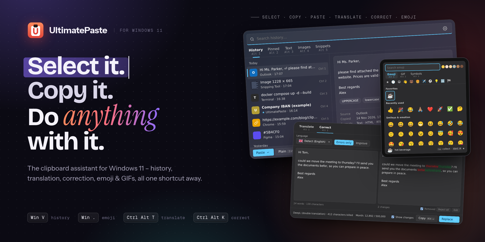
</p>

<p align="center">
  <a href="https://github.com/TheBigS1981/UltimatePaste/releases/latest"></a>
  
  <a href="LICENSE"></a>
  <a href="https://claude.com/claude-code"></a>
</p>

<p align="center">
  <a href="README.md">English</a> · <b>Deutsch</b>
</p>

---

**UltimatePaste** macht aus der Windows-Zwischenablage einen Assistenten. Alles beginnt mit **Markieren oder Kopieren**. Danach reicht ein Tastenkürzel, um es wiederzufinden, überall einzufügen, zu übersetzen, Schreibfehler zu korrigieren oder das passende Emoji oder GIF dazuzusetzen.

Schnell, per Tastatur bedienbar, in jedem Programm, und deine Daten bleiben verschlüsselt auf deinem PC.

<table>
  <tr>
    <td width="33%" valign="top"><b>📋 Kopieren &amp; Einfügen</b><br/>Durchsuchbarer Verlauf für Text, Links, Bilder und Dateien. Snippets, Schnellaktionen und Regeln je Programm.</td>
    <td width="33%" valign="top"><b>🌐 Übersetzen &amp; Korrigieren</b><br/>Text markieren, Taste drücken: direkt übersetzt oder korrigiert, mit DeepL oder KI und Wort-für-Wort-Vergleich.</td>
    <td width="33%" valign="top"><b>😊 Emoji, GIF &amp; Sonderzeichen</b><br/>Auswahl direkt am Text-Cursor, mit Hauttönen, Favoriten, GIFs, Stickern und 500 Sonderzeichen.</td>
  </tr>
</table>

## Inhalt

- [Download & Installation](#download--installation)
- [Zwischenablage-Verlauf](#-zwischenablage-verlauf)
- [Schnellaktionen, Snippets & Mehrfach-Einfügen](#-schnellaktionen-snippets--mehrfach-einfügen)
- [Emoji, GIF & Sonderzeichen](#-emoji-gif--sonderzeichen)
- [Übersetzen & Korrigieren](#-übersetzen--korrigieren)
- [Datenschutz & Sicherheit](#-datenschutz--sicherheit)
- [Einstellungen, Statistik & Tour](#%EF%B8%8F-einstellungen-statistik--tour)
- [Tastenkürzel](#%EF%B8%8F-tastenkürzel)
- [Häufige Fragen](#-häufige-fragen)
- [Selbst bauen](#-selbst-bauen)
- [Entwickelt mit Claude Code](#-entwickelt-mit-claude-code)

---

## Download & Installation

Die aktuelle Version gibt es unter **[Releases](https://github.com/TheBigS1981/UltimatePaste/releases/latest)**:

| Datei | Wofür |
|---|---|
| `UltimatePaste_<version>_x64-setup.exe` | **Installer** (empfohlen): ohne Admin-Rechte, mit Startmenü-Eintrag, normal deinstallierbar |
| `UltimatePaste-<version>-portable.exe` | **Portabel**: eine einzelne Datei, läuft von überall (am besten von einem lokalen Laufwerk, nicht vom Netzlaufwerk) |

Voraussetzung: Windows 11 (Windows 10 sollte gehen, ist aber nicht getestet), x64.

> [!IMPORTANT]
> **UltimatePaste ist noch nicht digital signiert.** Deshalb warnt Windows davor. Das ist bei neuen, unsignierten Programmen normal:
> - **SmartScreen** („Der Computer wurde durch Windows geschützt“): auf **Weitere Informationen** und dann **Trotzdem ausführen** klicken.
> - **Microsoft Defender** stuft einen frischen Build eventuell als `Trojan:Win32/…!ml` ein. Das `!ml` steht für eine Einschätzung per maschinellem Lernen bei unbekannten, unsignierten Dateien. Dann unter *Windows-Sicherheit → Schutzverlauf* **Zulassen** bzw. **Wiederherstellen** wählen, und gern [als Fehlalarm melden](https://www.microsoft.com/wdsi/filesubmission).
>
> Der vollständige Quellcode liegt in diesem Repository, und jedes Release führt die SHA-256-Prüfsummen seiner Dateien auf.

**Erster Start:** Eine kurze **Einführungstour** richtet Sprache und Tastenkürzel ein. Auf Wunsch trägst du dort auch DeepL- oder GIF-Schlüssel ein. Jeder Schritt lässt sich überspringen, und die Tour startest du unter *Einstellungen → Allgemein* jederzeit neu.

**Updates:** UltimatePaste schaut einmal täglich auf GitHub nach einer neuen Version; das lässt sich abschalten. Gibt es eine, fragt die App nach, lädt sie herunter, prüft die Prüfsumme und startet neu.

---

## 📋 Zwischenablage-Verlauf

Drück dein Kürzel (**`Strg+Umschalt+V`** als Standard, **`Win+V`** empfohlen). Dort findest du alles, was du kopiert hast: Text, Links, Bilder (mit Texterkennung), Dateien und Farben. Tippen sucht, **Enter** fügt in das Programm ein, aus dem du kamst.

<p align="center">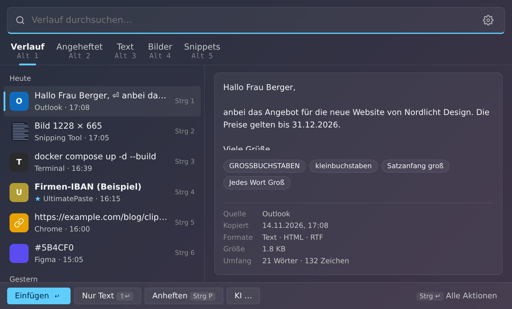</p>

- **Sofortige, fehlertolerante Suche** in Text, Titeln, Dateinamen, Quell-Programm und im Text von Screenshots (Texterkennung, läuft lokal)
- **Einfügen als …** formatiert, reiner Text, HTML oder RTF; `Strg+1…9` fügt einen Eintrag direkt ein
- Einträge **anheften, umbenennen, bearbeiten**, **nach Zeitraum löschen**, Aufnahme pausieren
- **Bilder-Reiter mit Texterkennung**: `Strg+T` kopiert den Text eines Screenshots
- **Nacheinander einfügen** (`Strg+Umschalt+Alt+V`): Jeder Druck fügt den nächstälteren Eintrag ein, praktisch für Formulare
- **Inbox-Export** (`Strg+I`): einen Eintrag als Markdown-Datei in einen Ordner ablegen, etwa in einen Obsidian-Vault
- Innerhalb von 10 Sekunden wieder geöffnet, geht es dort weiter, wo du warst

**Vier Fensterstile, acht Designs, hell und dunkel:**

<table>
  <tr>
    <td>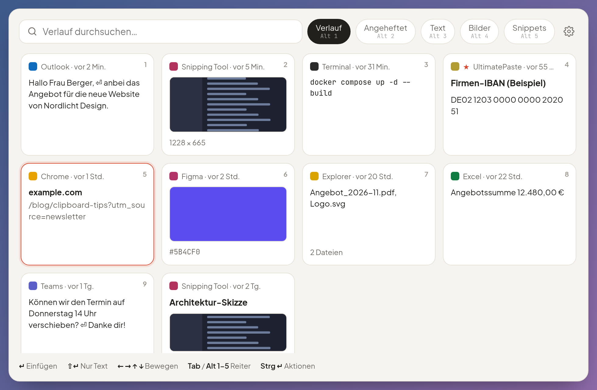</td>
    <td>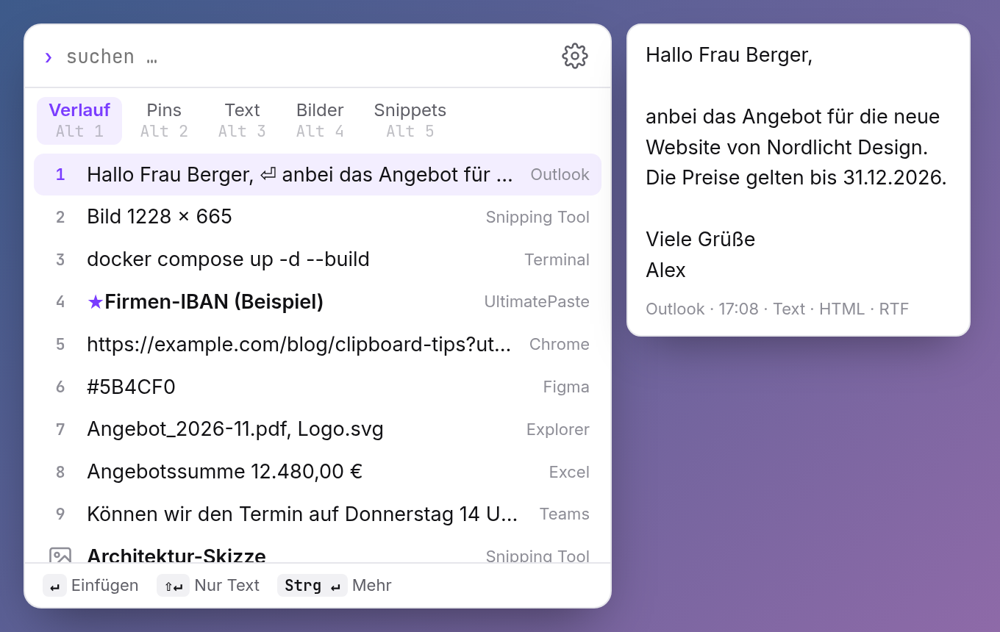</td>
    <td width="26%">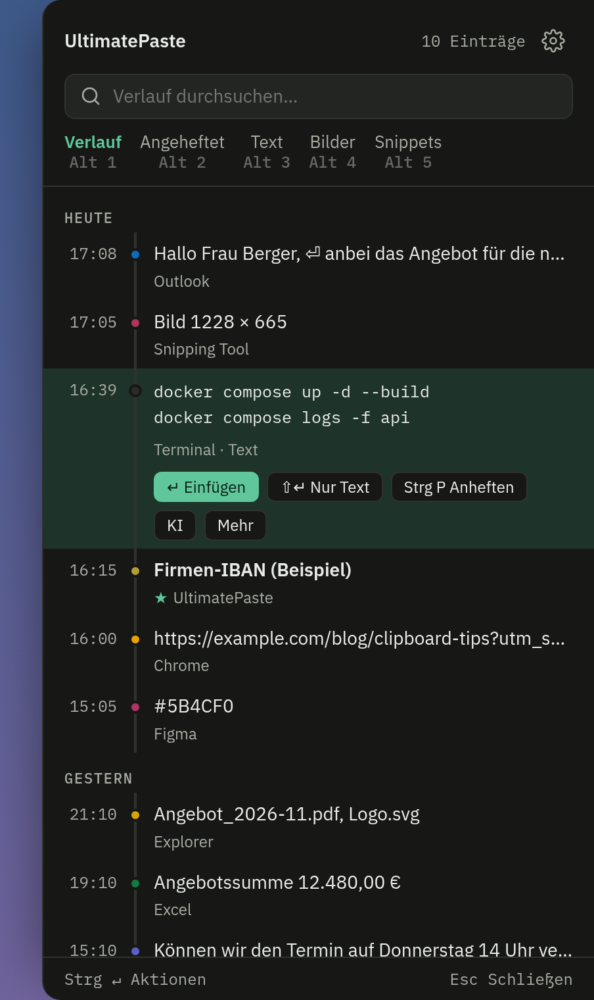</td>
  </tr>
  <tr>
    <td align="center"><sub>Pinnwand</sub></td>
    <td align="center"><sub>Kompakt (am Text-Cursor)</sub></td>
    <td align="center"><sub>Schublade</sub></td>
  </tr>
</table>

---

## ⚡ Schnellaktionen, Snippets & Mehrfach-Einfügen

**Schnellaktionen** erscheinen je nach Inhalt: JSON formatieren oder verkleinern, Farben umrechnen (HEX ↔ RGB ↔ HSL), Groß- und Kleinschreibung ändern, Links **ohne Tracking** einfügen, E-Mail schreiben, Nummer anrufen, Adresse in Karten öffnen oder ein Paket verfolgen (DHL, DPD, UPS, Hermes, GLS).

<p align="center">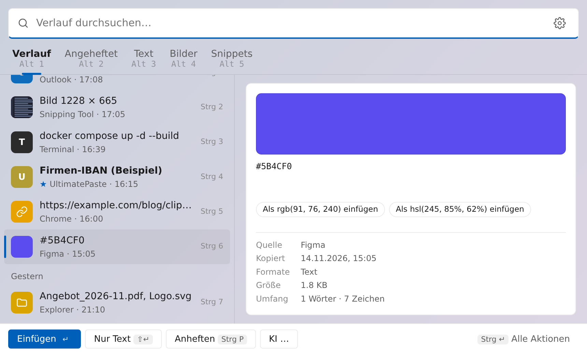</p>

**Snippets** sind wiederverwendbare Texte mit Platzhaltern: `{date}`, `{time}`, `{clipboard}` und `{cursor}`. Dazu kommen **Eingabefelder** wie `{eingabe:Name}` oder `{auswahl:Anrede|Frau|Herr}`, die vor dem Einfügen abgefragt werden. Mit **Snippets beim Tippen** genügt es, irgendwo `;kürzel` zu tippen, und das Snippet ersetzt es.

<p align="center">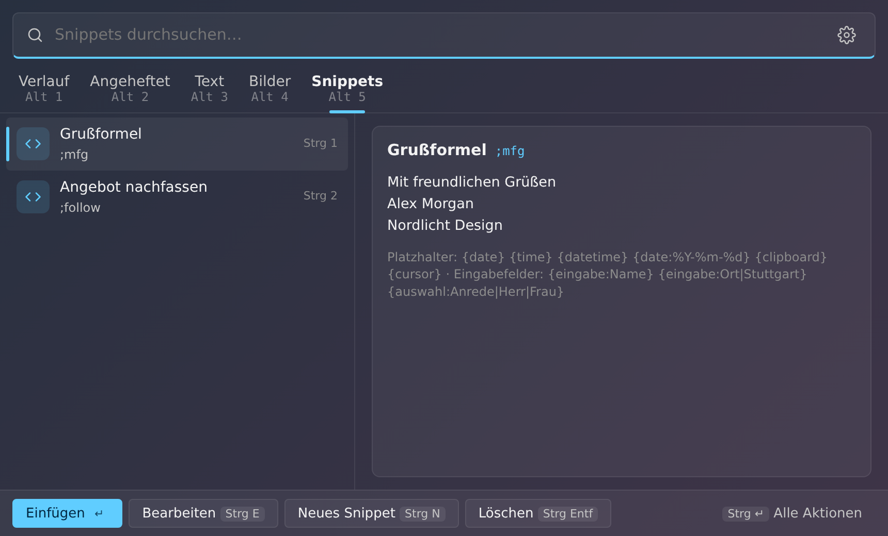</p>

- **Mehrere Einträge zusammen einfügen:** mit `Umschalt+Leertaste` oder `Strg+Klick` markieren und Enter drücken. Das Trennzeichen (Zeilenumbruch, Leerzeile, Komma, Aufzählung oder nummerierte Liste) wählst du im Aktionsmenü.
- **Regeln je Programm:** zum Beispiel in Outlook immer als reiner Text, im Terminal als eine Zeile.
- **KI-Aktionen** (`Strg+Enter`): korrigieren, umformulieren, zusammenfassen, Antwort entwerfen oder eigene Anweisungen, mit Claude oder jedem OpenAI-kompatiblen Dienst (Ollama, LM Studio, OpenRouter …).

---

## 😊 Emoji, GIF & Sonderzeichen

Drück **`Strg+.`** (oder übernimm **`Win+.`**), und die Auswahl öffnet sich **direkt am Text-Cursor**. Sie nimmt dem Programm, in dem du tippst, nie den Fokus weg, du tippst einfach weiter, um zu suchen.

<table>
  <tr>
    <td width="50%">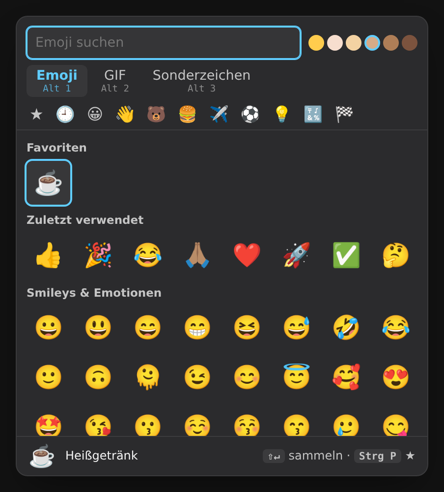</td>
    <td width="50%">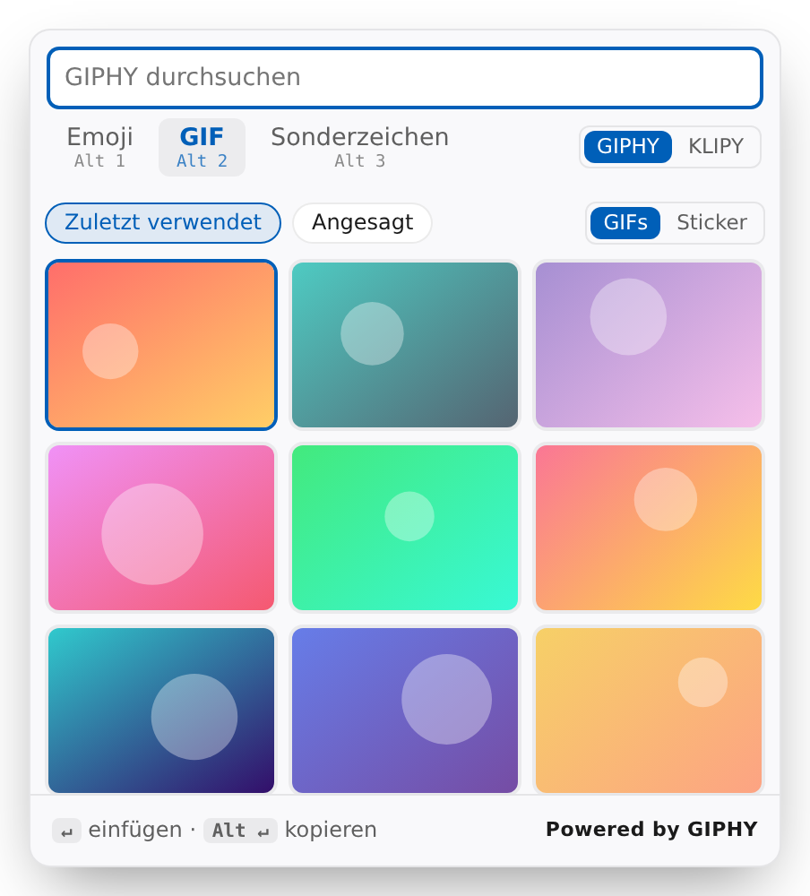</td>
  </tr>
</table>

- **Emoji** mit Suche in 9 Sprachen, Kategorien, Hauttönen (Standard und je Emoji per `Tab`), Favoriten (`Strg+P`) und „Zuletzt verwendet“; `Umschalt+Enter` sammelt mehrere
- **GIFs & Sticker** über GIPHY oder KLIPY mit deinem eigenen, kostenlosen Schlüssel, eingefügt als animierte Datei, HTML und Link
- **Rund 500 Sonderzeichen** (Pfeile, Währungen, Mathematik, Typografie …), suchbar nach Name oder Code (`U+2192`)
- `Alt+1/2/3` wechselt die Reiter

---

## 🌐 Übersetzen & Korrigieren

Text irgendwo markieren und **`Strg+Alt+T`** zum Übersetzen oder **`Strg+Alt+K`** zum Korrigieren drücken. Ohne Markierung nimmt die App den Inhalt der Zwischenablage.

<p align="center">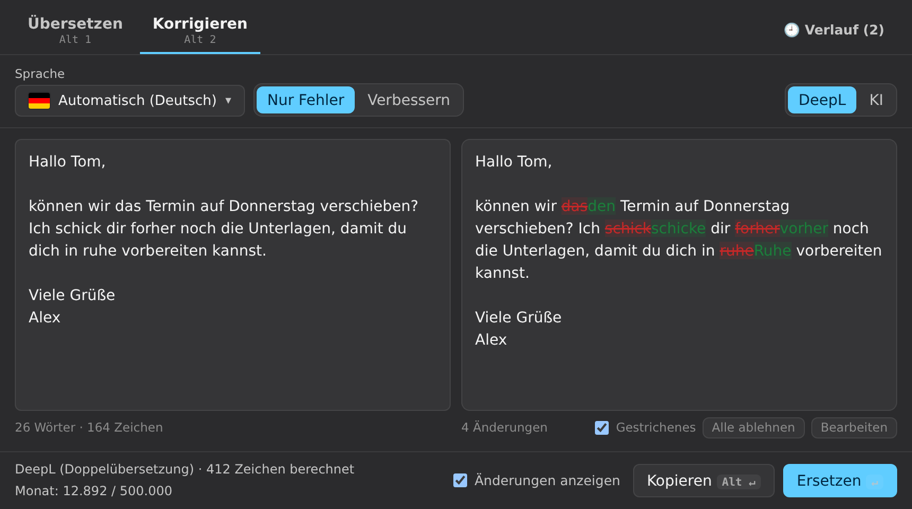</p>

- **Übersetzen** mit **DeepL** (Free oder Pro) oder einem **KI-Anbieter**: automatische Spracherkennung, Sprachpaar oder feste Zielsprache, Du oder Sie, vor dem Einfügen bearbeitbar oder direkt ersetzen
- **Korrigieren**: nur Fehler oder **verbessern** mit Stil oder Tonfall (einfach, geschäftlich, akademisch, locker, freundlich, selbstbewusst, diplomatisch …), über DeepL Write (Pro), eine DeepL-Doppelübersetzung (Free) oder KI
- **Wort-für-Wort-Vergleich**: Entferntes ist durchgestrichen, Neues hervorgehoben. Ein Klick auf eine Änderung lehnt sie ab.
- **Verlauf** der letzten 20 Vorgänge: Beim Schließen geht nichts verloren, und nichts wird doppelt bezahlt
- **Kosten im Blick:** Zeichen, Tokens, $ pro Vorgang und pro Monat

<p align="center">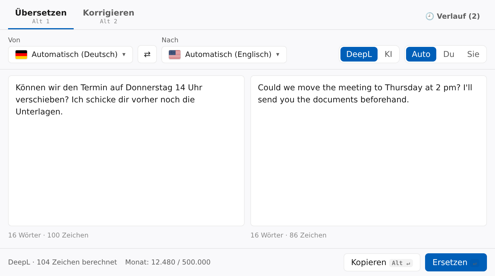</p>

---

## 🔒 Datenschutz & Sicherheit

- **Lokal und verschlüsselt:** Verlauf, Snippets, Statistik und Übersetzungsverlauf liegen AES-256-GCM-verschlüsselt auf deinem PC. Der Schlüssel ist an dein Windows-Konto gebunden (DPAPI).
- **Passwort-Manager werden ignoriert:** Als vertraulich markierte Inhalte (KeePass, Bitwarden, 1Password …) werden nie aufgenommen, und du kannst weitere Programme sperren.
- **Kurzlebige Geheimnisse verschwinden:** 2FA-Codes, Kartennummern und API-Schlüssel (optional auch IBANs) werden nach wenigen Minuten aus dem Verlauf gelöscht.
- **Links ohne Tracking:** `utm_…`, `fbclid`, `gclid` und andere lassen sich automatisch entfernen.
- **Nichts verlässt deinen PC ohne dich:** Text geht nur an DeepL oder den KI-Anbieter, wenn du übersetzt, korrigierst oder eine KI-Aktion startest. Suchbegriffe gehen nur an GIPHY oder KLIPY, wenn du GIFs suchst. API-Schlüssel liegen in der Windows-Anmeldeinformationsverwaltung.
- **Export & Import** von Einstellungen, Snippets, KI-Aktionen und Regeln. API-Schlüssel kommen nur auf Wunsch mit, mit einem Passwort versiegelt.

Vor Version 1.0 wurde der Code in einem Sicherheits-Audit geprüft. Wie du eine Sicherheitslücke meldest, steht in [SECURITY.md](SECURITY.md).

---

## ⚙️ Einstellungen, Statistik & Tour

Die Einstellungen sind nach den drei Bereichen gegliedert, jeweils mit ihren eigenen Tastenkürzeln. Überschneidungen mit Windows oder PowerToys werden erkannt und erklärt.

<table>
  <tr>
    <td width="50%">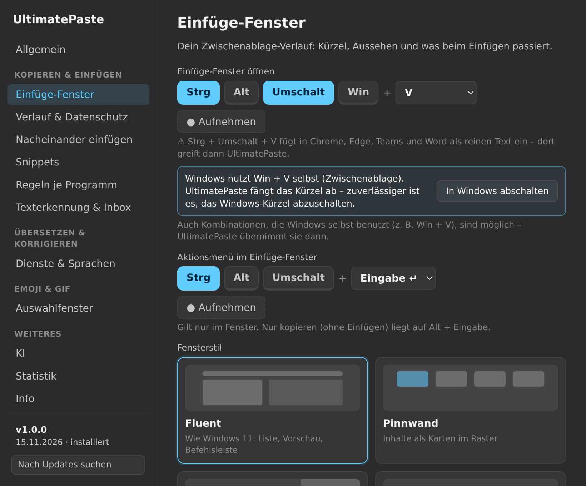</td>
    <td width="50%">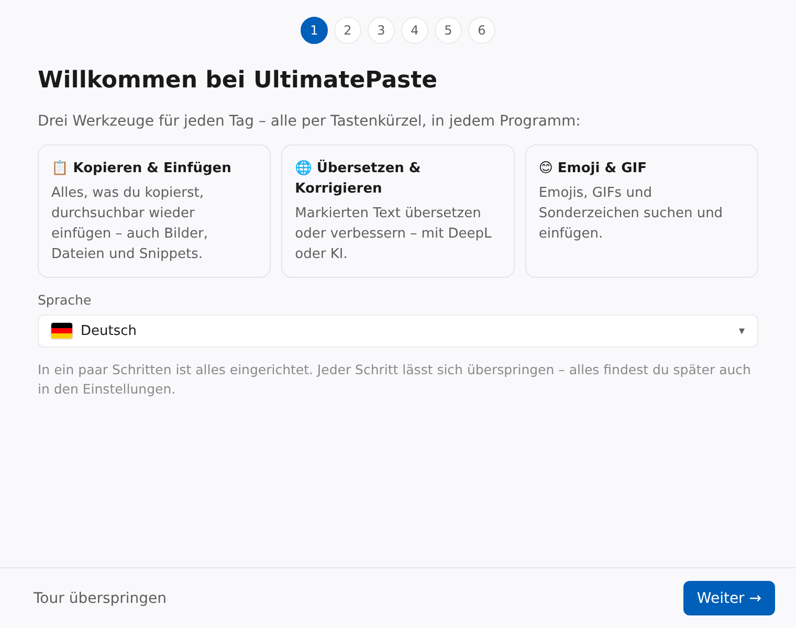</td>
  </tr>
</table>

Die **Statistik** zeigt, wie oft du einfügst, übersetzt und korrigierst, deine Top-Emojis und Sonderzeichen, die Programme, in die du einfügst, übersetzte Zeichen je Sprachpaar und die KI-Kosten pro Monat. Gespeichert werden nur Zähler, nie Inhalte.

<p align="center">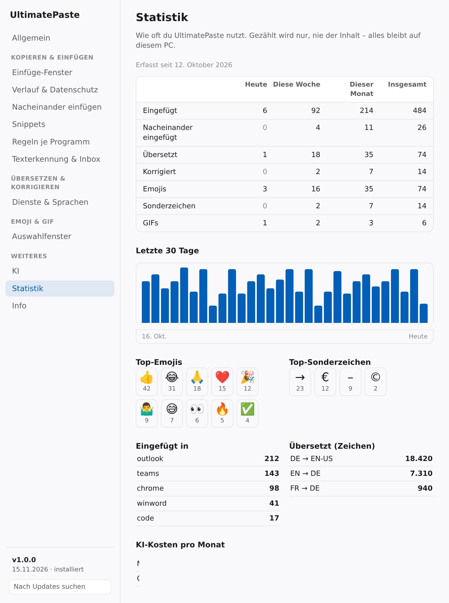</p>

**Sprachen:** Deutsch, English, Español, Français, Italiano, Nederlands, Polski, Português (Brasil), Tiếng Việt. Beim ersten Start nimmt die App die Anzeigesprache von Windows.

---

## ⌨️ Tastenkürzel

| Kürzel | Aktion |
|---|---|
| `Strg+Umschalt+V` (oder `Win+V`) | Einfüge-Fenster öffnen / schließen |
| `Strg+.` (oder `Win+.`) | Emoji, GIF & Sonderzeichen |
| `Strg+Alt+T` | Markierung übersetzen |
| `Strg+Alt+K` | Markierung korrigieren / verbessern |
| `Strg+Umschalt+Alt+V` | nacheinander einfügen |

**Im Einfüge-Fenster**

| Taste | Aktion |
|---|---|
| `↑ ↓` `Bild↑ Bild↓` | auswählen |
| `Enter` / `Umschalt+Enter` / `Alt+Enter` | einfügen / als reiner Text / nur kopieren |
| `Strg+1…9` | n-ten Eintrag einfügen |
| `Alt+1…5` / `Tab` | zu Reiter springen / nächster Reiter (Verlauf, Angeheftet, Text, Bilder, Snippets) |
| `Umschalt+Leertaste` / `Strg+Klick` | mehrere markieren, dann fügt `Enter` alle zusammen ein |
| `Strg+Enter` | Aktionsmenü (einfügen als …, Schnellaktionen, KI, nach Zeitraum löschen …) |
| `Strg+P` / `F2` / `Strg+E` | anheften / umbenennen / bearbeiten |
| `Strg+T` / `Strg+I` | Text aus Bild kopieren / in Inbox ablegen |
| `Strg+N` / `Strg+Entf` | neues Snippet / löschen |
| `Strg+,` | Einstellungen |
| `Esc` | Suche leeren / schließen |

Alle Kürzel lassen sich in den Einstellungen ändern, auch solche, die Windows selbst nutzt, wie `Win+V` und `Win+.`.

---

## ❓ Häufige Fragen

<details>
<summary><b>Kann UltimatePaste Win+V und Win+. ersetzen?</b></summary>

Ja. Du wählst sie in den Einstellungen oder in der Tour. Bei `Win+V` kann UltimatePaste zusätzlich das Windows-eigene Kürzel für den Zwischenablage-Verlauf abschalten; das wirkt ab der nächsten Anmeldung. `Win+.` übernimmt ein kleiner Tastatur-Hook. Die Emoji-Auswahl nimmt bewusst keinen Fokus, damit das Emoji-Feld von Windows nicht dazwischenkommt.
</details>

<details>
<summary><b>Brauche ich API-Schlüssel?</b></summary>

Nein. Verlauf, Snippets, Emoji und Sonderzeichen funktionieren ohne Schlüssel. Übersetzen und Korrigieren brauchen einen DeepL-Schlüssel (der kostenlose Tarif hat 500.000 Zeichen im Monat) oder einen KI-Anbieter. GIFs brauchen einen kostenlosen GIPHY- oder KLIPY-Schlüssel. Wo du welchen Schlüssel bekommst, erklären die Einstellungen Schritt für Schritt.
</details>

<details>
<summary><b>Wo liegen meine Daten, und wie lösche ich sie?</b></summary>

Unter `%LOCALAPPDATA%\UltimatePaste` (über *Einstellungen → Info* zu öffnen). Die Deinstallation lässt den Ordner stehen, damit eine Neuinstallation deinen Verlauf wiederfindet. Löschst du ihn, sind alle Daten weg.
</details>

<details>
<summary><b>Warum warnt Windows vor der App?</b></summary>

Weil sie noch nicht digital signiert ist (siehe [Download & Installation](#download--installation)). Die Signierung ist geplant.
</details>

<details>
<summary><b>Ein Emoji erscheint als Kästchen oder zwei Buchstaben (Flaggen)</b></summary>

Die Emoji-Schrift von Windows kennt nicht jedes neue Emoji und zeigt Flaggen als Buchstaben. UltimatePaste blendet Emojis aus, die Windows nicht darstellen kann. Flaggen sind die Ausnahme: In den meisten Browsern und in Teams erscheinen sie richtig.
</details>

---

## 🛠 Selbst bauen

Die App ist in Rust mit [Tauri 2](https://tauri.app) und einer Svelte-5-Oberfläche gebaut. Unter Linux lässt sie sich in Docker für Windows übersetzen:

```bash
./scripts/build-windows.sh               # → _out/UltimatePaste-<ver>-portable.exe
./scripts/build-windows.sh --installer   # + NSIS-Installer
docker compose run --rm -T -w /work/app/src-tauri builder cargo test --lib
```

Unter Windows: `cd app && npm ci && npx tauri dev`.
Vorschau der Oberfläche mit Beispieldaten in jedem Browser: `./scripts/screenshots.sh`. Die README-Bilder entstehen mit `./scripts/readme-shots.sh`.

**Daten von Dritten:** Emoji-Namen von [Emojibase](https://emojibase.dev) (MIT), Flaggen von [flag-icons](https://github.com/lipis/flag-icons) (MIT), GIF-Suche über [GIPHY](https://developers.giphy.com) und [KLIPY](https://klipy.com) mit dem eigenen Schlüssel der Nutzer. Die Oberflächen-Übersetzungen außer Deutsch und Englisch wurden maschinell unterstützt erstellt, Korrekturen sind sehr willkommen.

---

## 🤖 Entwickelt mit Claude Code

UltimatePaste wurde mit **[Claude Code](https://claude.com/claude-code)** entwickelt, dem agentischen Programmierwerkzeug von Anthropic. Ideen, Entscheidungen und Tests stammen von [@TheBigS1981](https://github.com/TheBigS1981). Claude Code hat Code, Tests, Übersetzungen und diese README geschrieben. Das Windows-spezifische Verhalten wurde gemeinsam mit einer Claude-Code-Sitzung direkt auf dem Ziel-PC geprüft.

## Lizenz

[MIT](LICENSE) © TheBigS1981
