<p align="center">
  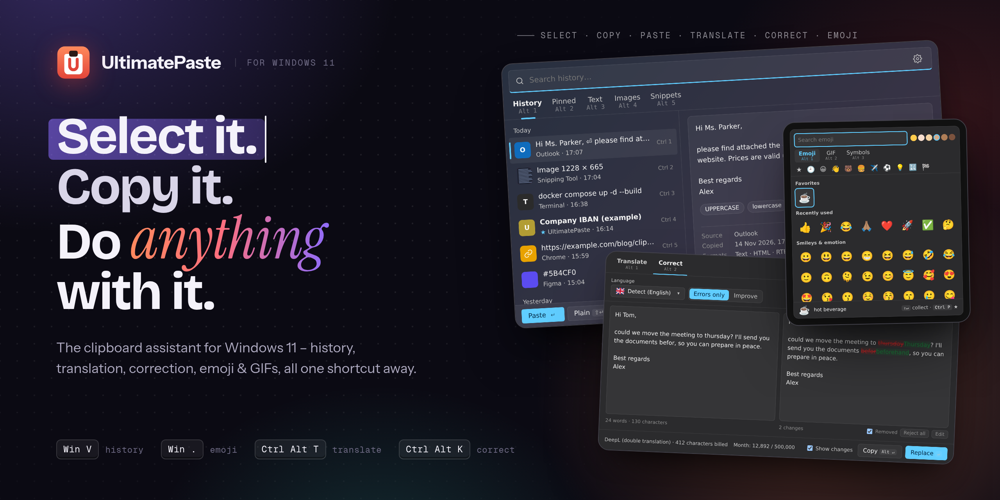
</p>

<p align="center">
  <a href="https://github.com/TheBigS1981/UltimatePaste/releases/latest"></a>
  
  <a href="LICENSE"></a>
  <a href="https://claude.com/claude-code"></a>
</p>

<p align="center">
  <b>English</b> · <a href="README.de.md">Deutsch</a>
</p>

---

**UltimatePaste** turns the Windows clipboard into an assistant. Everything starts with **selecting or copying**. Then one shortcut is enough to find it again, paste it anywhere, translate it, fix its spelling, or add the right emoji or GIF.

It is fast, keyboard-first, works in every program, and keeps your data on your PC, encrypted.

<table>
  <tr>
    <td width="33%" valign="top"><b>📋 Copy &amp; paste</b><br/>Searchable history of text, links, images and files. Snippets, quick actions and rules per program.</td>
    <td width="33%" valign="top"><b>🌐 Translate &amp; correct</b><br/>Select text, press a key: translated or corrected in place, with DeepL or AI and a word-by-word diff.</td>
    <td width="33%" valign="top"><b>😊 Emoji, GIF &amp; symbols</b><br/>A picker right at your text cursor, with skin tones, favorites, GIFs and stickers, and 500 special characters.</td>
  </tr>
</table>

## Contents

- [Download & install](#download--install)
- [Clipboard history](#-clipboard-history)
- [Quick actions, snippets & multi-paste](#-quick-actions-snippets--multi-paste)
- [Emoji, GIF & symbols](#-emoji-gif--symbols)
- [Translate & correct](#-translate--correct)
- [Privacy & security](#-privacy--security)
- [Settings, statistics & tour](#%EF%B8%8F-settings-statistics--tour)
- [Keyboard shortcuts](#%EF%B8%8F-keyboard-shortcuts)
- [FAQ](#-faq)
- [Building from source](#-building-from-source)
- [Built with Claude Code](#-built-with-claude-code)

---

## Download & install

Download the latest version from **[Releases](https://github.com/TheBigS1981/UltimatePaste/releases/latest)**:

| File | For |
|---|---|
| `UltimatePaste_<version>_x64-setup.exe` | **Installer** (recommended): no admin rights needed, adds a Start menu entry, can be uninstalled normally |
| `UltimatePaste-<version>-portable.exe` | **Portable**: a single file, runs from anywhere (preferably a local drive, not a network share) |

Requirements: Windows 11 (Windows 10 should work but isn't tested), x64.

> [!IMPORTANT]
> **UltimatePaste is not code-signed yet.** Windows therefore warns about it. That is expected for new, unsigned apps:
> - **SmartScreen** ("Windows protected your PC"): click **More info**, then **Run anyway**.
> - **Microsoft Defender** may flag a fresh build as `Trojan:Win32/…!ml`. The `!ml` stands for its machine-learning guess about unknown, unsigned files. If that happens, open *Windows Security → Protection history*, choose **Allow**/**Restore**, and feel free to [report it as a false positive](https://www.microsoft.com/wdsi/filesubmission).
>
> The complete source code is in this repository, and every release lists the SHA-256 checksums of its files.

**First start:** A short **welcome tour** sets up your language and shortcuts. Optionally you can also add your DeepL or GIF keys there. You can skip any step and restart the tour later under *Settings → General*.

**Updates:** UltimatePaste checks GitHub for a new version once a day; this can be switched off. When there is one, it asks you first, downloads it, verifies the checksum and restarts.

---

## 📋 Clipboard history

Press your shortcut (**`Ctrl+Shift+V`** by default, **`Win+V`** recommended). Everything you copied is there: text, links, images (with text recognition), files and colors. Start typing to search, then press **Enter** to paste into the program you came from.

<p align="center">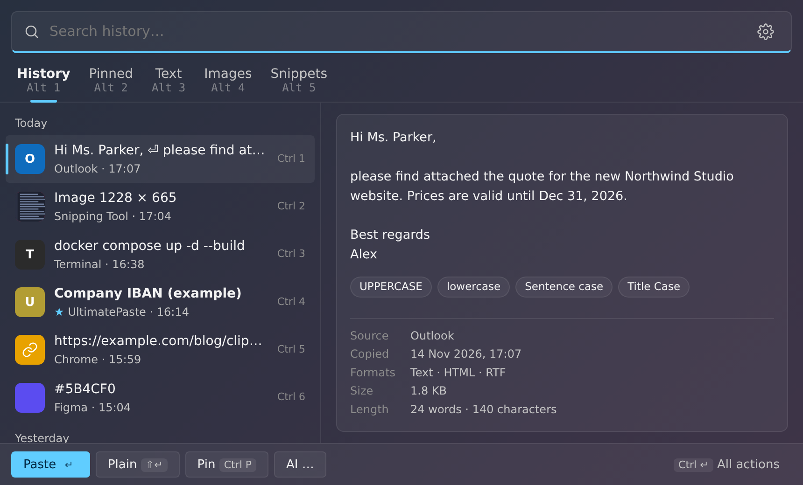</p>

- **Instant, typo-tolerant search** across text, titles, file names, source app and the text inside screenshots (OCR, runs locally)
- **Paste as…** rich text, plain text, HTML or RTF; `Ctrl+1…9` pastes an entry directly
- **Pin, rename, edit** entries, **delete by time range**, pause recording
- **Images tab with OCR**: `Ctrl+T` copies the text of a screenshot, `Ctrl+O` opens it in your image viewer
- **Paste sequentially** (`Ctrl+Shift+Alt+V`): each press pastes the next older entry, which is handy for filling forms
- **Inbox export** (`Ctrl+I`): send an entry as a Markdown file to a folder (for example an Obsidian vault)
- Reopen within 10 seconds and you continue where you left off

**Four window styles, eight designs, light and dark:**

<table>
  <tr>
    <td>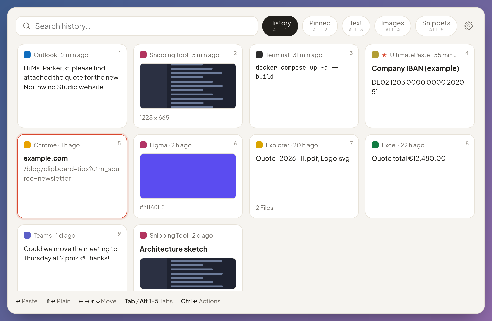</td>
    <td>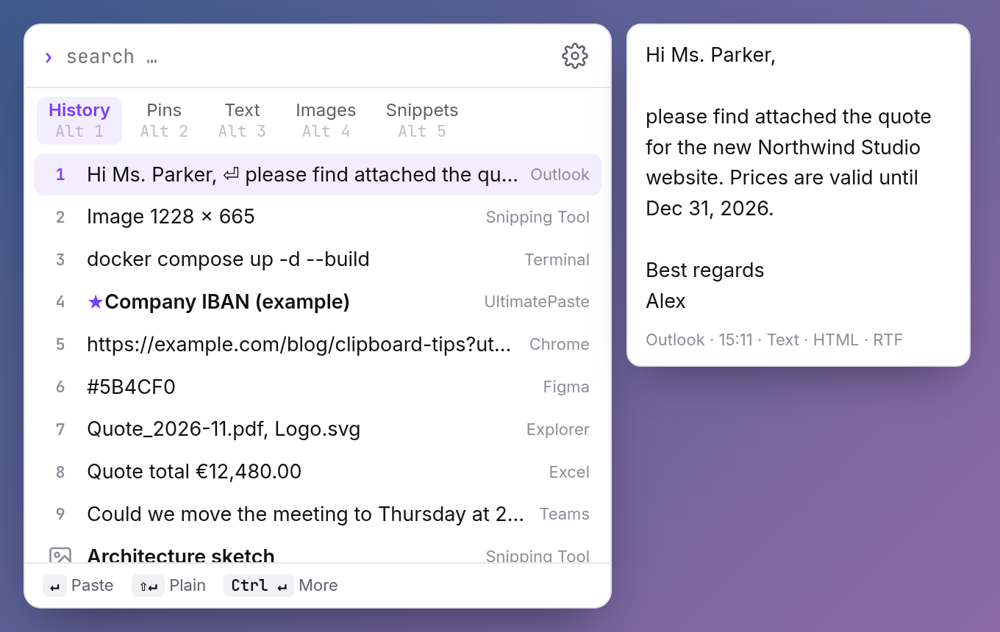</td>
    <td width="26%">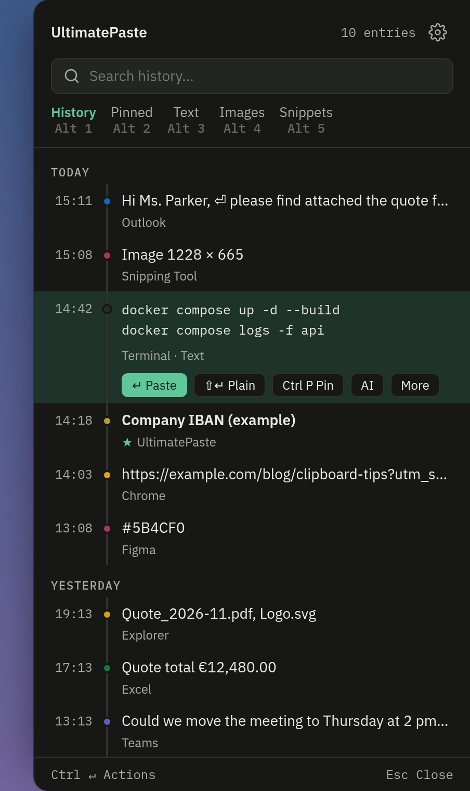</td>
  </tr>
  <tr>
    <td align="center"><sub>Board</sub></td>
    <td align="center"><sub>Compact (at the text cursor)</sub></td>
    <td align="center"><sub>Drawer</sub></td>
  </tr>
</table>

---

## ⚡ Quick actions, snippets & multi-paste

**Quick actions** appear depending on what you copied: format or minify JSON, convert colors (HEX ↔ RGB ↔ HSL), change case, paste a link **without tracking parameters**, write an e-mail, call a number, open an address in maps or track a parcel (DHL, DPD, UPS, Hermes, GLS).

<p align="center">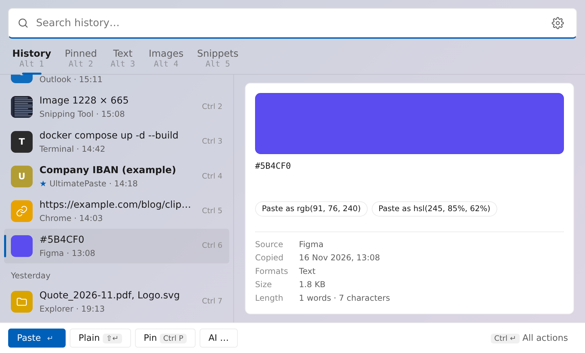</p>

**Snippets** are reusable texts with placeholders: `{date}`, `{time}`, `{clipboard}`, `{cursor}`, and **input fields** such as `{input:Name}` or `{select:Title|Mr|Ms}` that ask for values before pasting. You can also turn on **snippets while typing**: type `;keyword` in any program and it is replaced with the snippet.

<p align="center">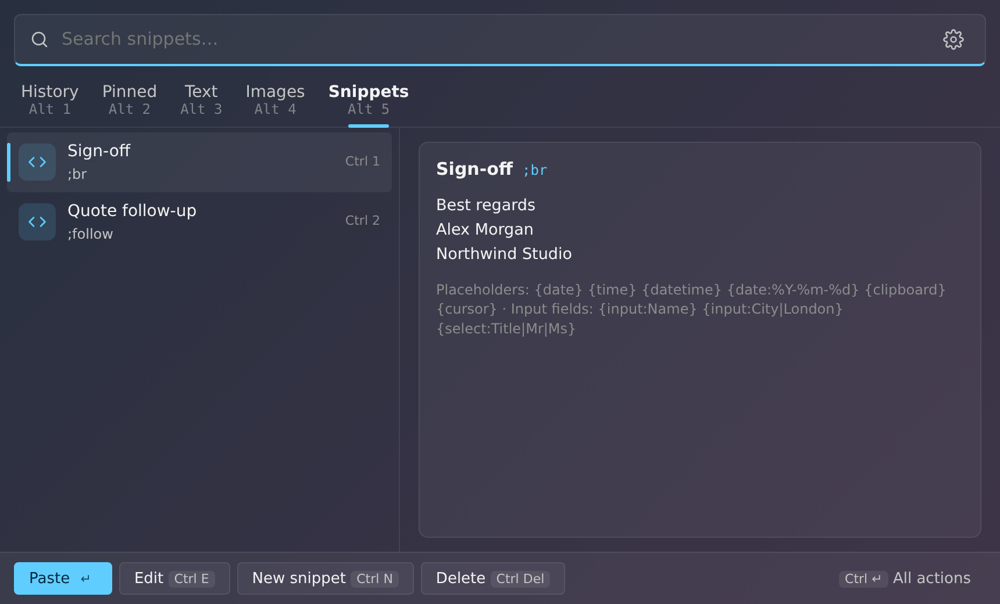</p>

If a typed snippet has input fields or choices, a small popup opens **right at your text cursor**. Pick with `↑` `↓` or `1`–`9`, type to filter, and press `Enter` to paste. `Esc` leaves the keyword as you typed it. The program you're typing in keeps the focus, and your clipboard stays untouched.

<p align="center">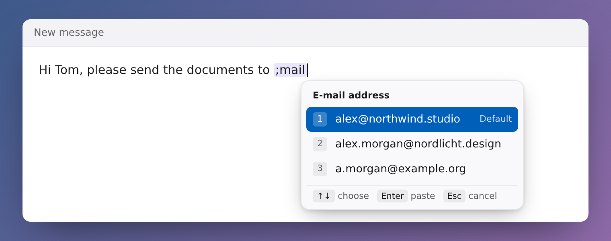</p>

- **Paste several entries together:** mark them with `Shift+Space` or `Ctrl+click`, then press Enter. The separator (new line, blank line, comma, bullet list or numbered list) is set in the actions menu.
- **Rules per program:** for example, always plain text in Outlook, or a single line in the terminal.
- **AI actions** (`Ctrl+Enter`): fix, rephrase, summarize, draft a reply, or your own prompts, using Claude or any OpenAI-compatible endpoint (Ollama, LM Studio, OpenRouter …).

---

## 😊 Emoji, GIF & symbols

Press **`Ctrl+.`** (or take over **`Win+.`**) and the picker opens **right at your text cursor** (or, if you prefer, at the mouse or in the middle of the screen; every window can be placed this way). It never takes the focus away from the program you're typing in: just keep typing to search.

<table>
  <tr>
    <td width="50%">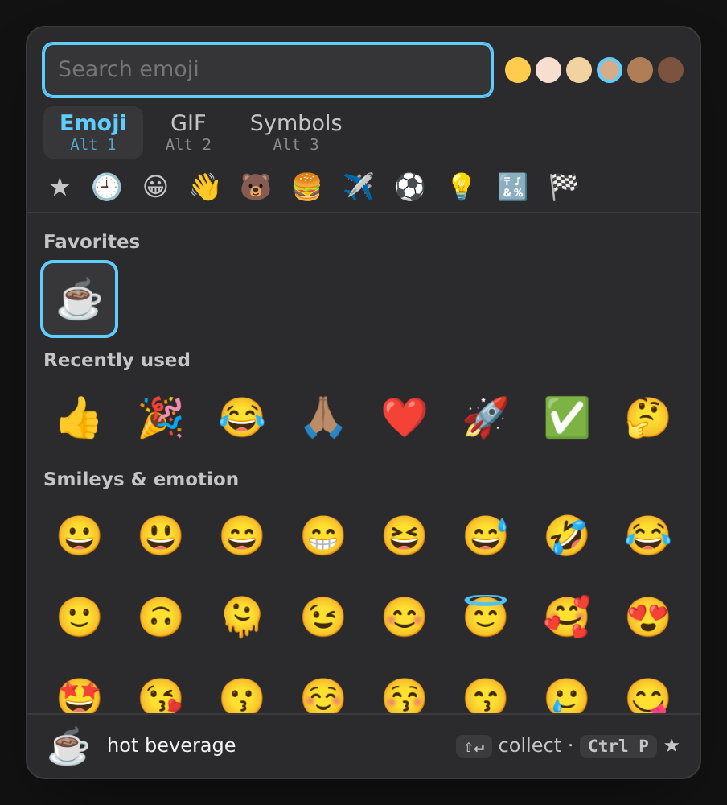</td>
    <td width="50%">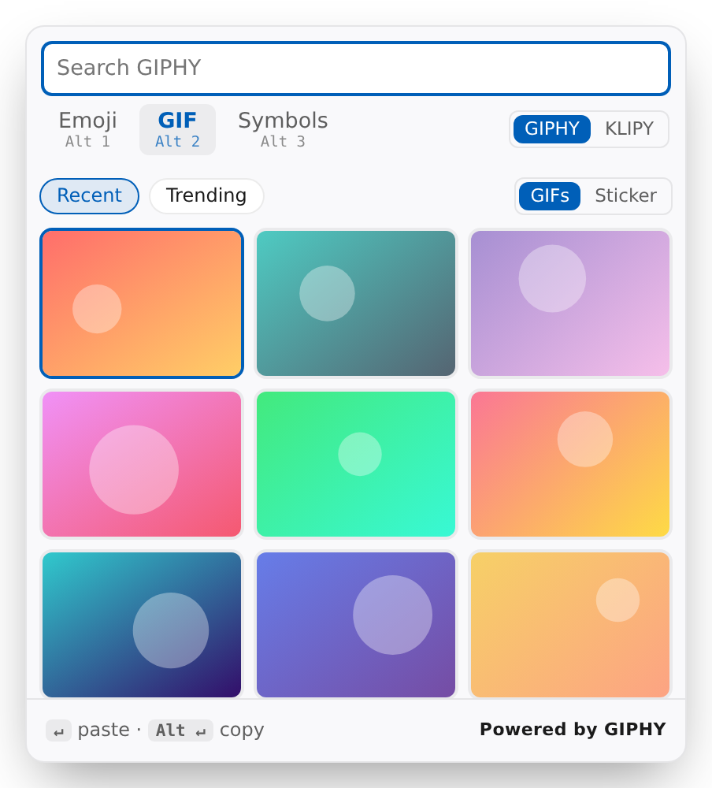</td>
  </tr>
</table>

- **Emoji** with search in 9 languages, categories, skin tones (default plus per emoji with `Tab`), favorites (`Ctrl+P`) and recently used; `Shift+Enter` collects several
- **GIFs & stickers** via GIPHY or KLIPY with your own free key; they are pasted as an animated file, HTML and link
- **~500 special characters** (arrows, currency, math, typography …), searchable by name or code point (`U+2192`)
- `Alt+1/2/3` switches between the tabs

---

## 🌐 Translate & correct

Select text anywhere and press **`Ctrl+Alt+T`** to translate or **`Ctrl+Alt+K`** to correct. Without a selection, the clipboard is used.

<p align="center">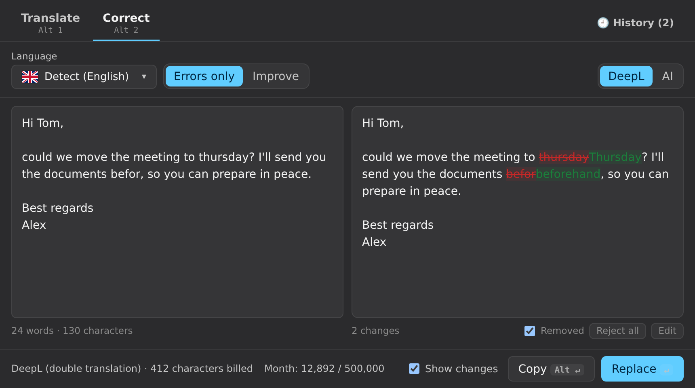</p>

- **Translate** with **DeepL** (Free or Pro) or an **AI provider**: automatic language detection, language pair or fixed target, formal/informal address, edit before pasting, or replace the selection directly
- **Correct** errors only, or **improve** the text with a style or tone (simple, business, academic, casual, friendly, confident, diplomatic …), via DeepL Write (Pro), a DeepL double translation (Free) or AI
- **Word-by-word diff**: removed text is struck through and new text is highlighted. Click a change to reject it.
- **History** of the last 20 runs, so nothing is lost when you close the window and you don't pay twice
- **Costs at a glance:** characters, tokens, $ per run and per month

<p align="center">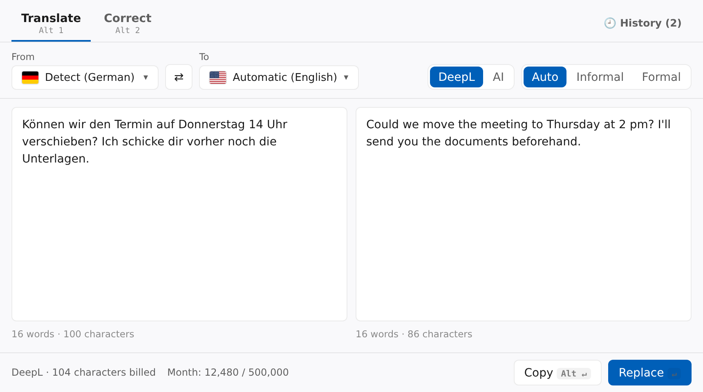</p>

---

## 🔒 Privacy & security

- **Local and encrypted:** history, snippets, statistics and translation history are stored with AES-256-GCM. The key is bound to your Windows account (DPAPI).
- **Password managers are ignored:** content marked as confidential (KeePass, Bitwarden, 1Password …) is never recorded, and you can block more programs.
- **Short-lived secrets disappear:** 2FA codes, card numbers and API keys (optionally IBANs) are removed from the history after a few minutes.
- **Links without tracking:** `utm_…`, `fbclid`, `gclid` and others can be stripped automatically.
- **Nothing leaves your PC unless you trigger it:** text only goes to DeepL or the AI provider when you translate, correct or run an AI action, and search terms only go to GIPHY/KLIPY when you search for GIFs. API keys are stored in the Windows Credential Manager.
- **Export & import** of settings, snippets, AI actions and rules. API keys go along only if you choose, sealed with a password.

The code was reviewed in a security audit before the 1.0 release. See [SECURITY.md](SECURITY.md) for how to report a vulnerability.

---

## ⚙️ Settings, statistics & tour

The settings are organized by the three areas, each with its own shortcuts. Conflicts with Windows or PowerToys are detected and explained.

<table>
  <tr>
    <td width="50%">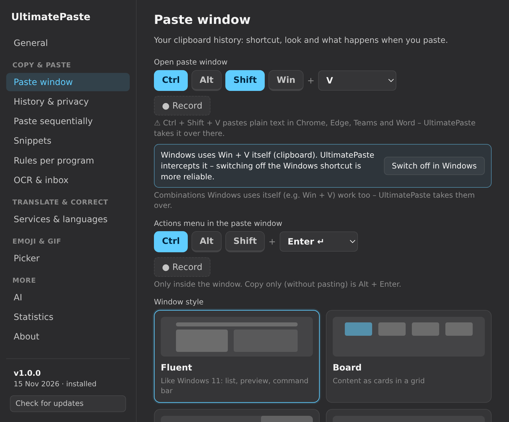</td>
    <td width="50%">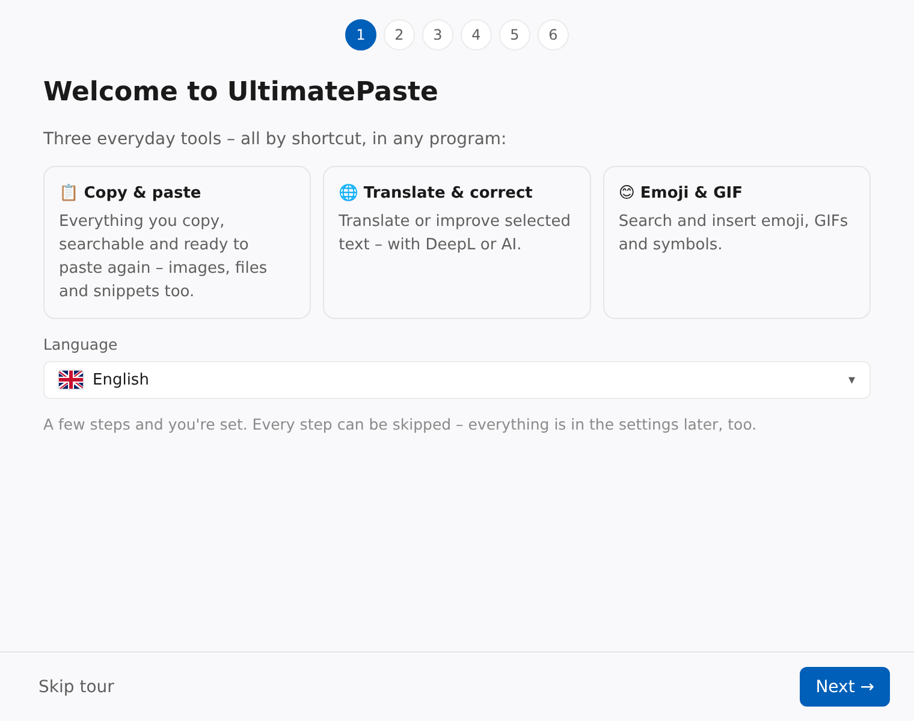</td>
  </tr>
</table>

**Statistics** show how often you paste, translate and correct, your top emoji and symbols, the apps you paste into, translated characters per language pair and AI costs per month. Only counters are stored, never content.

<p align="center">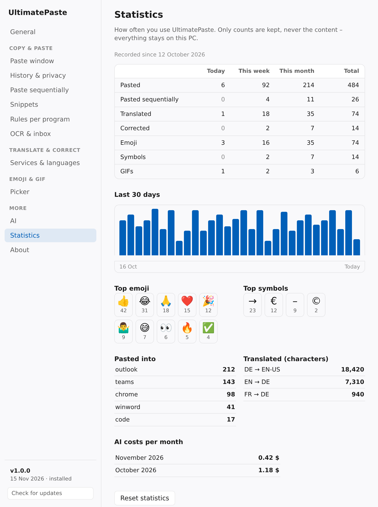</p>

**Languages:** English, Deutsch, Español, Français, Italiano, Nederlands, Polski, Português (Brasil), Tiếng Việt. On first start the app uses your Windows display language.

---

## ⌨️ Keyboard shortcuts

| Shortcut | Action |
|---|---|
| `Ctrl+Shift+V` (or `Win+V`) | open / close the paste window |
| `Ctrl+.` (or `Win+.`) | emoji, GIF & symbols |
| `Ctrl+Alt+T` | translate the selection |
| `Ctrl+Alt+K` | correct / improve the selection |
| `Ctrl+Shift+Alt+V` | paste sequentially |

**In the paste window**

| Key | Action |
|---|---|
| `↑ ↓` `PgUp PgDn` | select |
| `Enter` / `Shift+Enter` / `Alt+Enter` | paste / paste plain / copy only |
| `Ctrl+1…9` | paste the n-th entry |
| `Alt+1…5` / `Tab` | jump to / next tab (History, Pinned, Text, Images, Snippets) |
| `Shift+Space` / `Ctrl+click` | mark several entries, then `Enter` pastes them together |
| `Ctrl+Enter` | actions menu (paste as…, quick actions, AI, delete by time …) |
| `Ctrl+P` / `F2` / `Ctrl+E` | pin / rename / edit |
| `Ctrl+T` / `Ctrl+I` | copy text from image / send to inbox |
| `Ctrl+O` | open image in the image viewer |
| `Ctrl+N` / `Ctrl+Del` | new snippet / delete |
| `Ctrl+,` | settings |
| `Esc` | clear search / close |

All shortcuts can be changed in the settings, including ones Windows reserves such as `Win+V` and `Win+.`.

---

## ❓ FAQ

<details>
<summary><b>Can UltimatePaste replace Win+V and Win+.?</b></summary>

Yes. Choose them in the settings or in the tour. For `Win+V`, UltimatePaste can also switch off Windows' own clipboard history shortcut; this takes effect after the next sign-in. `Win+.` is taken over by a small keyboard hook, and the emoji picker deliberately doesn't take the focus, so Windows' emoji panel can't get in the way.
</details>

<details>
<summary><b>Do I need API keys?</b></summary>

No. The clipboard history, snippets, emoji and symbols work without any key. Translation and correction need a DeepL key (the free plan has 500,000 characters/month) or an AI provider. GIFs need a free GIPHY or KLIPY key. The settings explain step by step where to get each key.
</details>

<details>
<summary><b>Where is my data stored? How do I remove it?</b></summary>

In `%LOCALAPPDATA%\UltimatePaste` (open it via *Settings → About*). Uninstalling keeps the folder so that a reinstall finds your history again. Delete it to remove all data.
</details>

<details>
<summary><b>Why does Windows warn about the app?</b></summary>

Because it isn't code-signed yet (see [Download & install](#download--install)). Signing is planned.
</details>

<details>
<summary><b>An emoji shows as a box or two letters (flags)</b></summary>

Windows' emoji font doesn't contain every new emoji and shows flags as letters. UltimatePaste hides emoji that Windows can't display. Flags are the exception: they appear correctly in most browsers and in Teams.
</details>

---

## 🛠 Building from source

The app is Rust + [Tauri 2](https://tauri.app) with a Svelte 5 frontend. It can be cross-compiled from Linux in Docker:

```bash
./scripts/build-windows.sh               # → _out/UltimatePaste-<ver>-portable.exe
./scripts/build-windows.sh --installer   # + NSIS installer
docker compose run --rm -T -w /work/app/src-tauri builder cargo test --lib
```

On Windows: `cd app && npm ci && npx tauri dev`.
UI preview with dummy data in any browser: `./scripts/screenshots.sh` (the README images come from `./scripts/readme-shots.sh`).

**Third-party data:** emoji names from [Emojibase](https://emojibase.dev) (MIT), flags from [flag-icons](https://github.com/lipis/flag-icons) (MIT), GIF search via [GIPHY](https://developers.giphy.com) and [KLIPY](https://klipy.com) with each user's own key. The UI translations beyond English and German were machine-assisted, so corrections are very welcome.

---

## 🤖 Built with Claude Code

UltimatePaste was developed with **[Claude Code](https://claude.com/claude-code)**, Anthropic's agentic coding tool. The ideas, decisions and testing come from [@TheBigS1981](https://github.com/TheBigS1981), and Claude Code wrote the code, the tests, the translations and this README. Windows-specific behaviour was verified together with a Claude Code session on the target machine.

## License

[MIT](LICENSE) © TheBigS1981
